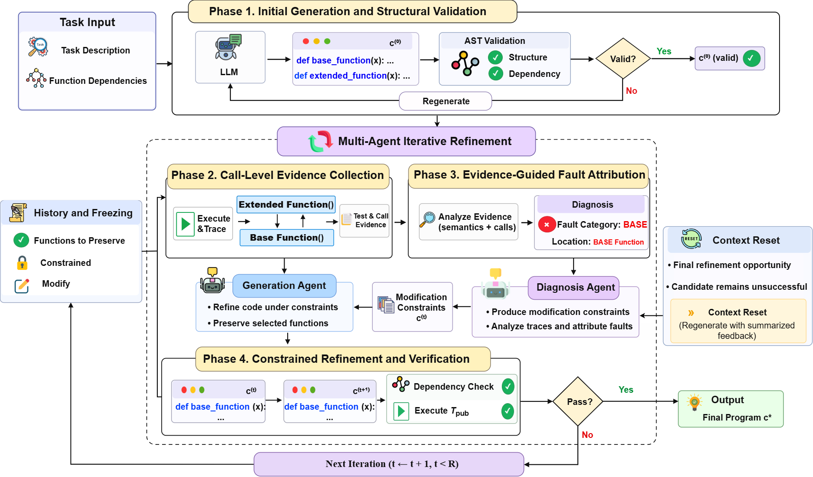

<div align="center">

# CLEAR Experiment
### Multi-Agent Structured Diagnosis and Refinement

[](https://www.python.org/)
[](https://www.docker.com/)
[](https://arxiv.org/abs/2412.21199)

</div>

---

**CLEAR** implements **Call-Level Evidence-Guided Attribution and Refinement** for self-invoking code generation. It is designed for programming tasks in which an extended function must explicitly invoke a required base function.

This repository contains only the core implementation. It does not include baselines, ablation variants, datasets, or experimental results.

## 1. Project Introduction

CLEAR combines dependency-guided generation, structural validation, call-level execution evidence, fault attribution, and constrained iterative refinement.

Its core features include:

- **🧩 Dependency-Guided Code Generation**

  Generates the base and extended functions from their specifications while preserving the required `extended -> base` dependency.

- **🔍 AST-Based Structural Validation**

  Uses Python AST analysis to verify syntax, required top-level function definitions, and the explicit dependency call.

- **📊 Call-Level Evidence Collection**

  Instruments the base function and records call IDs, arguments, keyword arguments, return values, exceptions, and completion status during public-test execution.

- **💡 Evidence-Guided Fault Attribution**

  Classifies failures as `BASE`, `CALL`, `EXT`, or `UNDETERMINED` by comparing function specifications with test feedback and recorded calls.

- **🔄 Constrained Refinement**

  Converts the diagnosis into explicit modification and preservation targets before requesting a refined candidate.

- **🔒 History and Freezing**

  Preserves historically supported functions unless later evidence requires them to change.

- **🔁 Context Reset**

  Uses summarized historical feedback and a fresh generation context for the final refinement opportunity.

- **🛡️ Sandbox Execution**

  Executes generated programs and tests inside an isolated Docker container with networking disabled and per-test time limits.

## 2. Approach

CLEAR employs a multi-stage iterative process to ensure quality in Assignment Code Generation:


## 3. Project Structure

```text
CLEAR/
|-- src/
|   |-- agents/              # Generation and diagnosis agents
|   |-- analysis/            # Contracts, AST checks, and call tracing
|   |-- experiments/         # Run records and local result persistence
|   |-- repair/              # Constraints and refinement prompts
|   |-- tests/               # Core unit tests
|   |-- config.py            # CLEAR protocol configuration
|   |-- data.py              # Dataset parsing and public/held-out split
|   |-- evaluation.py        # Final held-out evaluation
|   |-- llm.py               # OpenAI-compatible API client
|   |-- main.py              # Command-line entry point
|   `-- pipeline.py          # CLEAR Algorithm 1 workflow
|-- data/                    # User-provided datasets; ignored by Git
|-- docker/
|   `-- Dockerfile           # Isolated Python execution image
|-- .env.example             # Environment variable template
|-- .gitignore
|-- README.md
`-- requirements.txt         # Standard-library-only runtime
```

## 4. Environment Setup

### 4.1 System Requirements

- Python 3.12+
- Docker
- Git

### 4.2 Installation

```bash
# 1. Clone the repository
git clone https://github.com/yourusername/CLEAR.git
cd CLEAR

# 2. Create and activate a virtual environment
python -m venv .venv

# Linux/macOS
source .venv/bin/activate

# Windows PowerShell
.venv\Scripts\Activate.ps1

# 3. Install dependencies
python -m pip install -r requirements.txt

# 4. Build the sandbox image
docker build -t clear-sandbox:latest docker
```

### 4.3 Configuration

Copy `.env.example` to `.env` and provide an OpenAI-compatible endpoint:

```dotenv
CLEAR_API_KEY=
CLEAR_MODEL=your_model_id
CLEAR_API_ENDPOINT=https://example.com/v1/chat/completions
CLEAR_HUMANEVAL_PATH=data/humaneval_pro.json
CLEAR_MBPP_PATH=data/mbpp_pro.json
CLEAR_DOCKER_IMAGE=clear-sandbox:latest
```

All prompts sent to the model are written in English. API keys are read only from environment variables or the ignored local `.env` file.

### 4.4 Dataset Placement

Datasets are not included in this repository. Place CodeEval-Pro-compatible files at:

```text
data/humaneval_pro.json
data/mbpp_pro.json
```

Alternative locations can be supplied through `CLEAR_HUMANEVAL_PATH` and `CLEAR_MBPP_PATH`.

## 5. Usage

### 5.1 Run the Core Tests

```bash
python -m unittest discover -s src/tests -v
```

### 5.2 Run the Local Mock Workflow

The mock workflow does not require a dataset, Docker, or an API key.

```bash
python -m src.main --mode mock
```

### 5.3 Inspect Datasets and Docker

```bash
python -m src.main --mode inspect
```

### 5.4 Run One Task

```bash
python -m src.main --mode run \
  --dataset humaneval \
  --task-id 0 \
  --run-id clear-he-0 \
  --model YOUR_MODEL_ID \
  --model-kind open-weight \
  --api-endpoint https://example.com/v1/chat/completions \
  --max-api-requests 16 \
  --max-total-tokens 100000 \
  --allow-api
```

Omit `--task-id` to run the selected full dataset. Generated run records are written to `results/`, which is excluded from Git.

## 6. Notes

> [!IMPORTANT]
> **API key security:** never commit `.env` or API credentials. The repository includes only `.env.example` with empty placeholders.

> [!TIP]
> **Docker permissions:** on Linux, ensure the current user can run Docker commands without requiring an interactive password.

> [!WARNING]
> **Resource usage:** full-dataset runs can consume substantial API tokens. Always set `--max-api-requests` and `--max-total-tokens` according to your budget.

## 7. Contact

- Maintainer: Shao Ye
- Email: shaoye931@gmail.com
