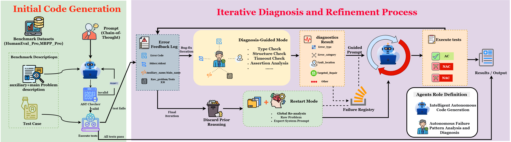

# MA-SDR Experiment
### Multi-Agent Structured Diagnosis and Refinement

---

**MA-SDR** Structured Iterative Reasoning via Multi-Agent Collaboration for Assignment Code Generation. This project is specifically optimized for **Aggregated Function Call Dependency Scenarios**.

## 1. Project Introduction

This project implements a closed-loop automated **Assignment Code Generation** and repair system. Its key features include:

*   **🧩 Aggregated Function Call Dependency Support**
    Supports the collaborative generation of **Auxiliary Functions** and **Main Functions**, ensuring logical decoupling and correct call dependencies between functions.

*   **🔍 AST Compliance Check**
    Performs static Abstract Syntax Tree (AST) analysis before code execution to enforce structural norms, ensuring the Main Function correctly calls the Auxiliary Function.

*   **🔄 Iterative Refinement**
    Supports multi-round self-correction, combining error diagnosis reports with targeted code refactoring.

*   **🛡️ Sandbox Execution**
    Uses Docker containers to execute generated code and test cases safely, preventing host system contamination.

*   **💡 Guided Diagnostics**
    Intelligently analyzes Runtime Errors and Assertion Failures to provide precise repair suggestions.

## 2. Approach
MA-SDR employs a multi-stage iterative process to ensure quality in Assignment Code Generation:

## 3. Project Structure
MA-SDR_Experiment/
|-- data/                    # Dataset directory (HumanEval-Pro, MBPP-Pro)
|-- src/                     # Source code directory
|   |-- agents/              # Diagnosis agents
|   |-- deepseek_client.py   # DeepSeek API client
|   |-- dual_task_*.py       # Dependency compliance & diagnostics
|   |-- sandbox_executor.py  # Docker sandbox executor
|   `-- main.py              # Main entry point
|-- docker/                  # Docker configuration
|-- results/                 # Results output directory
`-- requirements.txt         # Python dependencies

## 4. Environment Setup
# 4.1 System Requirements
    Python: 3.12+
    Docker: Required for sandbox execution.
    Git: For version control.
# 4.2 Installation
    # 1. Clone the repository
    git clone https://github.com/yourusername/MA-SDR_Experiment.git
    cd MA-SDR_Experiment
    
    # 2. Create and activate virtual environment
    python -m venv venv
    source venv/bin/activate    # Linux/macOS
    # venv\Scripts\activate     # Windows
    
    # 3. Install dependencies
    pip install -r requirements.txt
# 4.3 Configuration
Create a .env file in the project root:
    DEEPSEEK_API_KEY=sk-xxxxxxxxxxxxxxxx
    DEEPSEEK_BASE_URL=https://api.deepseek.com
    MODEL_TO_TEST=deepseek-coder
## 5. Notes
    [!IMPORTANT]
    API Key Security: Ensure .env is added to your .gitignore file. Never commit your API keys to a public repository.
    [!TIP]
    Docker Permissions: On Linux, ensure your user is added to the docker group to run commands without sudo.
    [!WARNING]
    Resource Usage: Large-scale experiments may consume a significant amount of API tokens. Monitor your usage quotas.
## 8. Contact
    Maintainer: [Shao ye]
    Email: shaoye931@gmail.com

